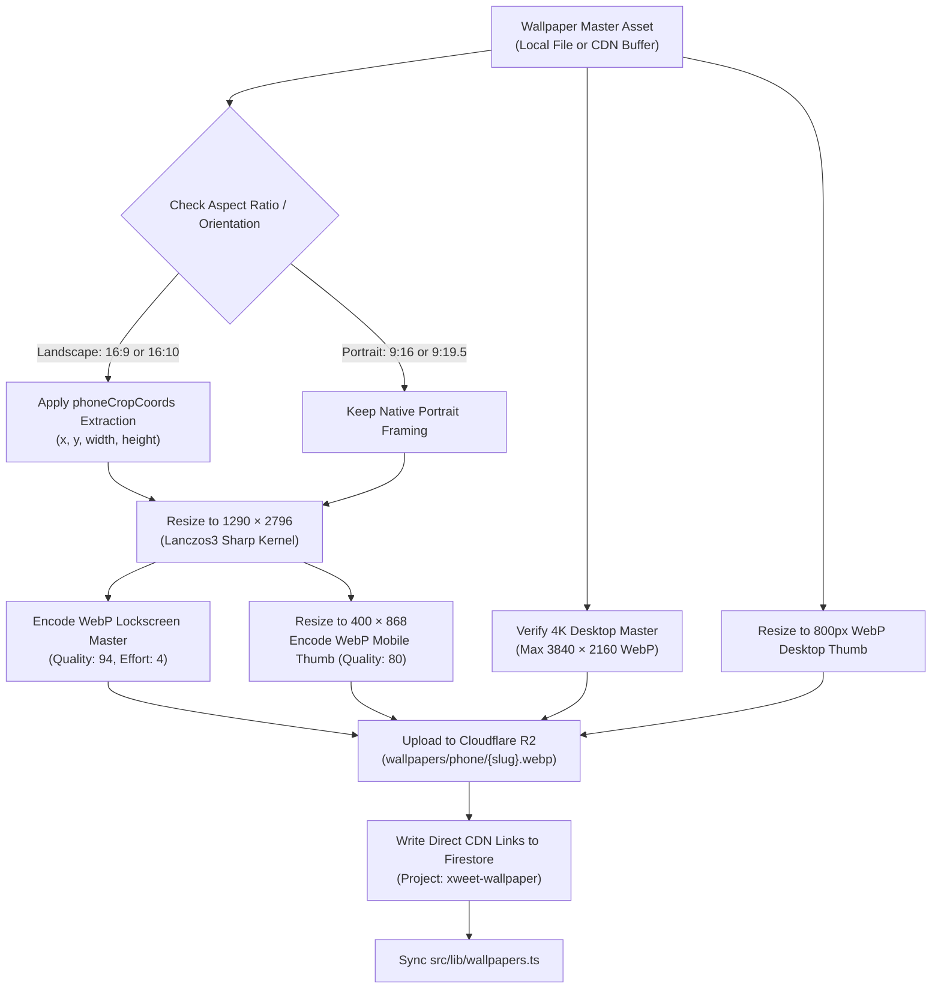

# Direct CDN Phone Asset Architecture & Migration Plan

A complete architectural blueprint to build, resize, deploy, and index permanent **Phone Master** and **Phone Thumbnail** assets on Cloudflare R2 and Google Firestore, eliminating any runtime dependency on Next.js for future mobile applications.

---

## 1. Executive Summary & Objective

Currently, mobile wallpapers are extracted dynamically on-the-fly via the Next.js server route `/api/download/[slug]?type=phone-4k`. While flexible, this creates a runtime dependency on the Next.js Node server.

### The "Reboosted" Serverless Architecture

By pre-rendering and publishing all phone assets directly to **Cloudflare R2** and indexing their immutable CDN links in **Cloud Firestore**:
1. **Zero Next.js Server Dependency**: Future mobile apps (Flutter, iOS, Android) connect directly to Cloud Firestore and stream images directly from Cloudflare R2 edge CDN (`https://cdn.xweet.in`).
2. **Instant Feed Loading**: Every wallpaper receives a dedicated lightweight **Phone Thumbnail** (`400 × 868px`, ~20–30 KB) designed specifically for mobile 2-column feeds.
3. **True Retina Lockscreens**: Every wallpaper receives a high-res **Phone Master** (`1290 × 2796px`, WebP quality 94) cropped according to verified `phoneCropCoords` or native vertical framing.
4. **Complete Resilience**: If the Next.js website is sleeping, down, or under maintenance, the mobile app continues to work with zero interruption at maximum edge speed.

---

## 2. Cloudflare R2 Storage Hierarchy

Assets are organized in a standardized, immutable directory structure within the `xweet` bucket:

```text
xweet (R2 Bucket)
└── wallpapers/
    ├── {slug}.webp                          # Full 4K Desktop Master (3840×2160 or master res)
    ├── thumbnails/
    │   └── {slug}.webp                      # Desktop Grid Thumbnail (800px width)
    └── phone/
        ├── {slug}.webp                      # Full Mobile Lockscreen Master (1290×2796 Retina WebP)
        └── thumbnails/
            └── {slug}.webp                  # Mobile Feed Thumbnail (400×868 WebP, ~25KB)
```

### Public CDN URL Mapping

| Asset Type | Cloudflare R2 Key | Public CDN URL | Dimensions | Target Use Case |
|---|---|---|---|---|
| **Phone Lockscreen Master** | `wallpapers/phone/{slug}.webp` | `https://cdn.xweet.in/wallpapers/phone/{slug}.webp` | `1290 × 2796` | Fullscreen mobile lockscreen preview & native wallpaper setter |
| **Phone Feed Thumbnail** | `wallpapers/phone/thumbnails/{slug}.webp` | `https://cdn.xweet.in/wallpapers/phone/thumbnails/{slug}.webp` | `400 × 868` | Fast mobile 2-column feed grid with zero latency pop-in |
| **Desktop 4K Master** | `wallpapers/{slug}.webp` | `https://cdn.xweet.in/wallpapers/{slug}.webp` | `3840 × 2160` | High-res desktop monitor edition & dual download bundle |
| **Desktop Thumbnail** | `wallpapers/thumbnails/{slug}.webp` | `https://cdn.xweet.in/wallpapers/thumbnails/{slug}.webp` | `800 × auto` | Web catalog grid view |

---

## 3. Clean, Minimal Firestore Document Schema

Every document in the Firestore **`wallpapers`** collection uses a clean, single source of truth for URLs (`urls` object). There are zero redundant top-level URL keys:

```json
{
  "id": "wp-01",
  "slug": "midnight-amber",
  "title": "Midnight Amber",
  "description": "Flowing midnight-blue forms meet a delicate amber glow in this textured abstract wallpaper. A calm, cinematic backdrop for a focused desktop.",
  "classification": {
    "category": "Dark Abstract",
    "collection": "Minimal Abstracts",
    "aspectRatio": "16:9",
    "resolution": "2752 × 1536"
  },
  "styling": {
    "dominantColor": "#111B2A",
    "paletteHex": "#D99562",
    "palette": [
      "#111B2A",
      "#344153",
      "#D99562"
    ],
    "tags": [
      "minimal",
      "abstract",
      "navy",
      "amber",
      "dark blue",
      "grain texture",
      "flowing curves",
      "desktop"
    ]
  },
  "flags": {
    "isFeatured": true,
    "isNew": true,
    "hasPhoneCrop": true,
    "hasDedicatedPhone": true
  },
  "author": {
    "id": "xweet",
    "username": "xweet",
    "displayName": "Vicky",
    "photoURL": "/logo.png",
    "isVerified": true
  },
  "storage": {
    "r2Key": "wallpapers/midnight-amber.webp",
    "format": "webp",
    "phoneCropCoords": {
      "x": 680,
      "y": 0,
      "width": 864,
      "height": 1536
    }
  },
  "urls": {
    "phone": "https://cdn.xweet.in/wallpapers/phone/midnight-amber.webp",
    "phoneThumbnail": "https://cdn.xweet.in/wallpapers/phone/thumbnails/midnight-amber.webp",
    "desktop": "https://cdn.xweet.in/wallpapers/midnight-amber.webp",
    "desktopThumbnail": "https://cdn.xweet.in/wallpapers/thumbnails/midnight-amber.webp"
  },
  "metadata": {
    "publishedAt": "2026-10-14",
    "createdAt": 1791934171013
  }
}
```

---

## 4. Orientation & Image Transformation Engine

The processing script handles every wallpaper according to its orientation:



---

## 5. Future Flutter App Direct Integration (Zero Next.js Dependency)

With this clean structure, the Flutter application interacts directly with Firestore and Cloudflare R2:

```dart
// In Flutter Wallpaper Model:
class WallpaperUrls {
  final String phone;
  final String phoneThumbnail;
  final String desktop;
  final String desktopThumbnail;

  WallpaperUrls({
    required this.phone,
    required this.phoneThumbnail,
    required this.desktop,
    required this.desktopThumbnail,
  });

  factory WallpaperUrls.fromJson(Map<String, dynamic> json) => WallpaperUrls(
    phone: json['phone'] as String,
    phoneThumbnail: json['phoneThumbnail'] as String,
    desktop: json['desktop'] as String,
    desktopThumbnail: json['desktopThumbnail'] as String,
  );
}

// In Flutter UI Feed Grid Card:
CachedNetworkImage(
  imageUrl: wallpaper.urls.phoneThumbnail,   // Fast 400x868 WebP thumbnail (~25KB)
  placeholder: (context, url) => Container(
    color: Color(int.parse(wallpaper.styling.dominantColor.replaceFirst('#', '0xFF'))),
  ),
  errorWidget: (context, url, error) => const Icon(Icons.broken_image),
  fit: BoxFit.cover,
)

// In Flutter Fullscreen Lockscreen Preview & Native Wallpaper Setter:
CachedNetworkImage(
  imageUrl: wallpaper.urls.phone,            // Lossless 1290x2796 4K Retina Lockscreen Master
  fit: BoxFit.cover,
)
```

---

## 6. Verification Status

| Step | Task | Status |
|---|---|---|
| **Step 1** | Verify `serviceAccountKey.json` (`xweet-wallpaper`) & Cloudflare R2 credentials | **Completed ✓** |
| **Step 2** | Synchronize [.env.local](file:///c:/Users/rajvi/Repo/xweet-wallpaper/.env.local) with `xweet-wallpaper` project ID and keys | **Completed ✓** |
| **Step 3** | Process & deploy all 37 base wallpapers to R2 and Firestore | **Completed ✓** |
| **Step 4** | Ingest, crop, and deploy all 26 new phone wallpapers from `New folder/` | **Completed ✓** |
| **Step 5** | Purge redundant top-level URL keys from Firestore & [src/lib/wallpapers.ts](file:///c:/Users/rajvi/Repo/xweet-wallpaper/src/lib/wallpapers.ts) | **Completed ✓ (All 63 docs cleaned)** |
| **Step 6** | TypeScript typecheck (`npx tsc --noEmit`) and Next.js static build (`npm run build`) | **0 Errors, 81 Pages Static Built ✓** |
