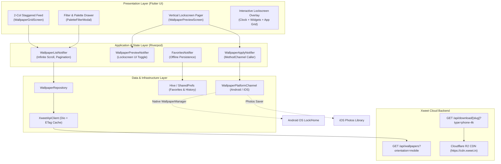
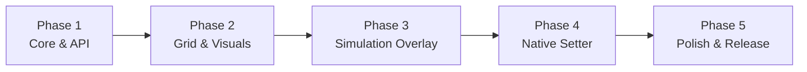

# Flutter Phone Wallpaper App — Architectural Plan & Specification

A comprehensive engineering blueprint for building a high-performance, mobile-only wallpaper application using **Flutter (Dart)**, powered by the **Xweet Wallpapers** REST API, Cloudflare R2 CDN, and dynamic 4K lockscreen cropping engine.

---

## 1. Product Vision & Scope

The Flutter application is designed exclusively for **handheld mobile screens** (iOS & Android). Rather than displaying generic landscape images, every wallpaper in the catalog is either natively vertical (`9:16` / `9:19.5`) or dynamically extracted from 4K masters using verified `phoneCropCoords`.

### Core Values

- **Handheld-First**: Every artwork is framed and optimized for modern phone aspect ratios (`9:19.5` iPhone 15/16 Pro and `9:20` Samsung Galaxy / Android flagships).
- **Warm Editorial Minimalism**: Follows the Xweet brand identity—calm cream background (`#F6F3E9`), forest green accents (`#244B38`), crisp geometry, and image-first composition.
- **Zero-Latency Perceived Loading**: Uses `dominantColor` and `palette` extracted from Firestore metadata to render instant color placeholders before image bytes arrive.
- **Lockscreen Simulation**: Allows users to preview live time, date, flashlight/camera widgets, and homescreen app grids over any wallpaper *before* downloading or applying.
- **Native Wallpaper Engine**: One-tap application directly to Android Lockscreen, Homescreen, or Both via native platform channels.

---

## 2. System Architecture

The app adopts a **Feature-First Clean Architecture** with **Riverpod (v2)** for reactive state management and **Dio** for caching and HTTP networking.



---

## 3. Technology Stack Selection

| Responsibility | Library / Tool | Reason & Benefit |
|---|---|---|
| **Framework** | Flutter 3.24+ / Dart 3.5+ | Single codebase for iOS and Android with 60/120fps native rendering. |
| **State Management** | `flutter_riverpod` + `riverpod_annotation` | Compile-time safe, testable, decoupled dependency injection with code generation. |
| **Networking** | `dio` + `dio_cache_interceptor` | First-class support for HTTP caching, ETags (304 Not Modified), and request cancelation. |
| **Image Loading** | `cached_network_image` + `flutter_cache_manager` | Disk and memory multi-tier caching with placeholder builder for zero pop-in. |
| **Local Storage** | `hive_ce` / `hive_flutter` | Lightweight, fast NoSQL key-value database for favorites, downloaded history, and settings. |
| **Android Wallpaper** | `async_wallpaper` or Custom MethodChannel | Direct access to Android `WallpaperManager` for `FLAG_LOCK`, `FLAG_SYSTEM`, or both. |
| **iOS Integration** | `image_gallery_saver` + `permission_handler` | Saves lossless image to iOS Photos with clear instructions for Wallpaper customization. |
| **Haptic Feedback** | `flutter/services.dart` (`HapticFeedback`) | Subtle tactile response on bookmarking, color swatching, and wallpaper download. |

---

## 4. Backend API Integration & Data Contracts

The Flutter application connects directly to the existing Xweet Wallpapers backend.

### 4.1 Base URLs & Endpoints

- **Production Base URL**: `https://wallpaper.xweet.in`
- **Catalog Endpoint**: `GET /api/wallpapers?orientation=mobile&page={page}&limit=24`
- **Dynamic Lockscreen Asset**: `GET /api/download/{slug}?type=phone-4k&format=webp` (or `format=jpg` for Android wallpaper engines requiring JPEG)

### 4.2 Data Model (Dart / Freezed)

```dart
// lib/features/wallpapers/domain/models/wallpaper.dart
import 'package:freezed_annotation/freezed_annotation.dart';

part 'wallpaper.freezed.dart';
part 'wallpaper.g.dart';

@freezed
class Wallpaper with _$Wallpaper {
  const factory Wallpaper({
    required String id,
    required String slug,
    required String title,
    required String description,
    required WallpaperClassification classification,
    required WallpaperStyling styling,
    required WallpaperAuthor author,
    required WallpaperUrls urls,
    required WallpaperFlags flags,
    String? publishedAt,
    int? createdAt,
  }) = _Wallpaper;

  factory Wallpaper.fromJson(Map<String, dynamic> json) => _$WallpaperFromJson(json);
}

@freezed
class WallpaperClassification with _$WallpaperClassification {
  const factory WallpaperClassification({
    required String category,
    required String collection,
    required String aspectRatio,
    required String resolution,
  }) = _WallpaperClassification;

  factory WallpaperClassification.fromJson(Map<String, dynamic> json) =>
      _$WallpaperClassificationFromJson(json);
}

@freezed
class WallpaperStyling with _$WallpaperStyling {
  const factory WallpaperStyling({
    required String dominantColor,
    required String paletteHex,
    required List<String> palette,
    required List<String> tags,
  }) = _WallpaperStyling;

  factory WallpaperStyling.fromJson(Map<String, dynamic> json) =>
      _$WallpaperStylingFromJson(json);
}

@freezed
class WallpaperUrls with _$WallpaperUrls {
  const factory WallpaperUrls({
    required String phone,
    required String phoneThumbnail,
    String? desktop,
    String? desktopThumbnail,
  }) = _WallpaperUrls;

  factory WallpaperUrls.fromJson(Map<String, dynamic> json) =>
      _$WallpaperUrlsFromJson(json);
}

@freezed
class WallpaperFlags with _$WallpaperFlags {
  const factory WallpaperFlags({
    @Default(false) bool isFeatured,
    @Default(false) bool isNew,
    @Default(true) bool hasPhoneCrop,
  }) = _WallpaperFlags;

  factory WallpaperFlags.fromJson(Map<String, dynamic> json) =>
      _$WallpaperFlagsFromJson(json);
}

@freezed
class WallpaperAuthor with _$WallpaperAuthor {
  const factory WallpaperAuthor({
    required String name,
    required String username,
    required String avatarUrl,
    @Default(true) bool isVerified,
    String? bio,
  }) = _WallpaperAuthor;

  factory WallpaperAuthor.fromJson(Map<String, dynamic> json) =>
      _$WallpaperAuthorFromJson(json);
}
```

---

## 5. UI/UX Design & Core Screens

### 5.1 Color Tokens & Typography (Xweet Design System)

```dart
// lib/core/theme/app_colors.dart
import 'package:flutter/material.dart';

class AppColors {
  static const Color background = Color(0xFFF6F3E9);       // Warm cream
  static const Color surface = Color(0xFFFCFAF4);          // Elevated light surface
  static const Color foreground = Color(0xFF252923);       // Dark charcoal body text
  static const Color primary = Color(0xFF244B38);          // Deep Forest Green
  static const Color primaryHover = Color(0xFF193A2A);
  static const Color secondary = Color(0xFFDCE5D5);        // Soft Sage
  static const Color secondaryForeground = Color(0xFF244B38);
  static const Color muted = Color(0xFFEAE7DD);            // Divider / subtle tint
  static const Color mutedForeground = Color(0xFF62685E);  // Metadata / captions
  static const Color border = Color(0xFFD9D8C9);           // Crisp 1px outline
  static const Color accent = Color(0xFF858B70);           // Olive accent
}
```

### 5.2 Key Screens

#### Screen 1: The Curated Mobile Feed (`WallpaperFeedScreen`)
- **Grid Layout**: 2-column staggered grid (`aspectRatio: 9 / 19.5`).
- **Card Experience**:
  - Crisp border (`1px solid var(--border)`), `0px` radius (or subtle `2px`).
  - Pre-renders background using `wallpaper.styling.dominantColor` before image arrives.
  - Floating bottom bar: author attribution, mini palette swatches, and "NEW" badge.
  - Pull-to-refresh with tactile haptic tick.

#### Screen 2: Immersion Lockscreen Pager (`WallpaperPreviewScreen`)
- **Full-Screen Vertical Pager** (swipe up/down or left/right between drops).
- **Interactive Lockscreen Simulation Overlay**:
  - Live local device clock (e.g., `09:41`) and day/date rendered in typographic hierarchy.
  - Simulated Dynamic Island / punch-hole camera notch.
  - Floating bottom flashlight and camera shortcut pills.
  - **Toggle Modes**:
    1. *Clean View*: Pure artwork with no overlay.
    2. *Lockscreen View*: Time, date, and lockscreen widgets.
    3. *Homescreen View*: Semi-transparent grid of app icons to preview readability.
- **Action Drawer**:
  - One-tap "Set Wallpaper" button.
  - "Save to Photos" button.
  - Palette swatches with "Tap to Copy HEX" or "Filter by this tone".
  - Curated author and license info.

#### Screen 3: Palette & Mood Explorer (`PaletteExplorerScreen`)
- Interactive horizontal color ring with dominant shades extracted from current wallpapers.
- Tapping a color (e.g. `#111B2A` Midnight or `#D99562` Amber) immediately filters the catalog.

#### Screen 4: Offline Favorites (`FavoritesScreen`)
- Fast local storage through Hive; saved wallpapers viewable even in airplane mode.

---

## 6. Native Wallpaper Setting Engine

### 6.1 Android Implementation (MethodChannel)

Android allows native programmatic setting of Lockscreen and Homescreen wallpapers via `android.app.WallpaperManager`.

```kotlin
// android/app/src/main/kotlin/in/xweet/wallpaper/MainActivity.kt
package in.xweet.wallpaper

import android.app.WallpaperManager
import android.graphics.BitmapFactory
import android.os.Build
import io.flutter.embedding.android.FlutterActivity
import io.flutter.embedding.engine.FlutterEngine
import io.flutter.plugin.common.MethodChannel
import java.io.File

class MainActivity: FlutterActivity() {
    private val CHANNEL = "in.xweet.wallpaper/setter"

    override fun configureFlutterEngine(flutterEngine: FlutterEngine) {
        super.configureFlutterEngine(flutterEngine)
        MethodChannel(flutterEngine.dartExecutor.binaryMessenger, CHANNEL).setMethodCallHandler { call, result ->
            val filePath = call.argument<String>("filePath")
            val target = call.argument<Int>("target") // 1: Home, 2: Lock, 3: Both

            if (filePath == null) {
                result.error("INVALID_PATH", "File path cannot be null", null)
                return@setMethodCallHandler
            }

            try {
                val bitmap = BitmapFactory.decodeFile(filePath)
                val manager = WallpaperManager.getInstance(applicationContext)

                if (Build.VERSION.SDK_INT >= Build.VERSION_CODES.N) {
                    when (target) {
                        1 -> manager.setBitmap(bitmap, null, true, WallpaperManager.FLAG_SYSTEM)
                        2 -> manager.setBitmap(bitmap, null, true, WallpaperManager.FLAG_LOCK)
                        else -> {
                            manager.setBitmap(bitmap, null, true, WallpaperManager.FLAG_SYSTEM or WallpaperManager.FLAG_LOCK)
                        }
                    }
                } else {
                    manager.setBitmap(bitmap)
                }
                result.success(true)
            } catch (e: Exception) {
                result.error("SET_WALLPAPER_ERROR", e.localizedMessage, null)
            }
        }
    }
}
```

### 6.2 iOS Implementation Strategy

Due to Apple iOS sandbox security restrictions, third-party apps cannot programmatically set wallpapers without user confirmation. The iOS implementation will:
1. Save the full 4K WebP/PNG directly to the iOS Photos library using the PhotoKit framework.
2. Present a native iOS bottom sheet dialog guiding the user to:
   * *Settings > Wallpaper > Add New Wallpaper*, or
   * *Photos > Share > Use as Wallpaper*.
3. Optionally trigger the native iOS Shortcuts URL scheme to launch the Wallpaper editor if user enables it.

---

## 7. Recommended Directory Structure

```text
lib/
├── app.dart                                # MaterialApp configuration & routing
├── main.dart                               # App entry point & initialization
│
├── core/
│   ├── constants/                          # API endpoints, default assets
│   ├── network/                            # Dio client, cache interceptor, error handling
│   ├── storage/                            # Hive storage service & preferences
│   ├── theme/                              # AppColors, AppTypography, ThemeData
│   └── utils/                              # Color parser, haptics, share helpers
│
├── features/
│   ├── wallpapers/
│   │   ├── data/
│   │   │   ├── datasources/                # Remote Xweet API & Local DB
│   │   │   └── repositories/               # WallpaperRepository implementation
│   │   ├── domain/
│   │   │   ├── models/                     # Wallpaper, Styling, Urls models (Freezed)
│   │   │   └── repositories/               # IWallpaperRepository interface
│   │   └── presentation/
│   │       ├── controllers/                # Riverpod Notifiers (feed, filters, pagination)
│   │       ├── screens/
│   │       │   ├── wallpaper_feed_screen.dart
│   │       │   ├── wallpaper_detail_screen.dart
│   │       │   └── favorites_screen.dart
│   │       └── widgets/
│   │           ├── wallpaper_grid_card.dart
│   │           ├── lockscreen_preview_overlay.dart
│   │           ├── homescreen_grid_overlay.dart
│   │           ├── set_wallpaper_bottom_sheet.dart
│   │           └── palette_swatch_bar.dart
│   │
│   └── author/
│       ├── presentation/screens/author_profile_screen.dart
│       └── presentation/widgets/author_badge.dart
│
└── platform/
    └── wallpaper_service.dart              # Platform channel abstraction
```

---

## 8. Five-Phase Implementation Roadmap



### Phase 1: Core Foundation & API Layer (Days 1–3)
- Initialize Flutter project with bundle IDs `in.xweet.wallpaper`.
- Configure `dio` network client with edge cache headers and error handling.
- Build Dart data models (`Wallpaper`, `Urls`, `Styling`) with Freezed and JSON serialization.
- Implement `WallpaperRepository` calling `https://wallpaper.xweet.in/api/wallpapers?orientation=mobile`.

### Phase 2: Staggered Mobile Feed & Caching (Days 4–7)
- Build 2-column staggered grid with `cached_network_image`.
- Implement `dominantColor` placeholder containers to achieve zero layout shift.
- Wire infinite pagination with Riverpod (`ScrollController` listener).
- Implement style/category filter drawer and color palette chip filter.

### Phase 3: Lockscreen Immersion & Simulation Mode (Days 8–11)
- Develop the full-screen vertical swipeable `PageView`.
- Build the real-time device clock and widget simulation overlay.
- Build the homescreen app icon grid overlay for readability testing.
- Add tap-to-copy hex functionality on palette swatches.

### Phase 4: Native Android & iOS Wallpaper Engine (Days 12–15)
- Implement Android MethodChannel for `WallpaperManager` (Lock, Home, Both).
- Implement iOS PhotoKit export flow with modal instruction dialog.
- Integrate local Hive database for favorite bookmarks and downloaded wallpapers history.
- Add offline fallback so bookmarked wallpapers remain viewable without network.

### Phase 5: Polish, Performance & Store Prep (Days 16–18)
- Test on physical iOS devices (iPhone 14/15/16) and Android devices (Samsung One UI, Pixel).
- Verify image memory consumption and implement proactive garbage collection on deep scroll.
- Configure App Icons, Splash Screen (`flutter_native_splash`), and light/dark theme handling.
- Prepare Google Play Store & Apple App Store assets.

---

## 9. Key Open Decisions for Discussion

1. **Native Engine Preference**:
   - *Option A*: Custom Kotlin MethodChannel (minimal dependencies, maximum control over Android 7–15 lockscreen flags).
   - *Option B*: Standard package `async_wallpaper` (faster setup, pre-tested across diverse Android OEM skins).
2. **Download Format for Native Android**:
   - The backend `/api/download/{slug}` outputs WebP by default. Older Android devices may prefer JPEG/PNG for system wallpapers. The client should request `&format=png` or `&format=jpg` for native wallpaper setting to ensure 100% device compatibility.
3. **App Architecture Distribution**:
   - Would you like this Flutter project housed in a separate standalone repository (e.g. `xweet-wallpaper-flutter`) or in a `/mobile` monorepo directory inside this existing project?
