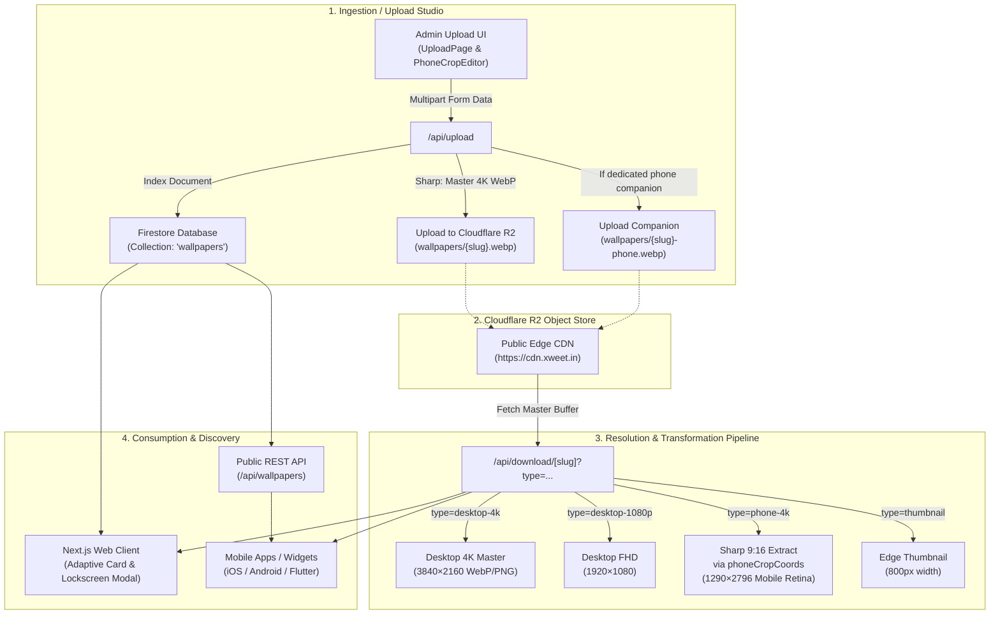

# Xweet Wallpapers — Storage & Asset Architecture Report

An in-depth technical analysis of how wallpaper assets are indexed in **Google Firestore**, stored in **Cloudflare R2**, and distinguished between **Phone** and **Desktop** editions across the entire Xweet Wallpapers application.

---

## Executive Summary

Xweet Wallpapers uses a **Single 4K WebP Master** architecture with dynamic server-side transformation, supported by a dual-variant capability for dedicated artwork:

1. **Firestore Metadata**: Stores a normalized document per wallpaper drop inside the `wallpapers` collection. Documents contain structured sub-objects for `classification` (aspect ratio, resolution, category), `storage` (R2 keys and 2D bounding crop coordinates), `styling` (dominant color and palette), `flags` (featured, phone crop status), and `author` profile details.
2. **Cloudflare R2 Storage**: Serves as the S3-compatible immutable object store behind `https://cdn.xweet.in`. The modern architecture stores a single, highly-optimized 4K WebP master (`wallpapers/{slug}.webp`), eliminating redundant pre-generated thumbnails and resolution files. An optional dedicated companion file (`wallpapers/{slug}-phone.webp`) is supported when authors upload distinct mobile compositions.
3. **Phone vs. Desktop Distinction**: Handled multidimensionally through:
   - **Upload Modes**: `desktop`, `mobile` (portrait lockscreen), or `dual` (master + dynamic crop window or dual files).
   - **Data Attributes**: `aspectRatio` (`16:9` vs `9:16` / `9:19.5`), `orientation` (`desktop` vs `mobile`), and `storage.phoneCropCoords`.
   - **Dynamic Cropping Pipeline (`/api/download/[slug]`)**: Uses Sharp to extract a pixel-perfect vertical phone lockscreen on-the-fly using the stored crop coordinates or streams the uncropped 4K desktop master.
   - **Adaptive UI Presentation**: `WallpaperCard` automatically renders mobile-proportioned crops with lockscreen notch overlays on mobile devices, and landscape masters on desktop screens.

---



---

## 1. How Wallpapers Are Stored in Firestore Metadata

All wallpaper drops are stored as individual documents within the top-level **`wallpapers`** collection. The document ID follows the format `wp-XX` (legacy static catalog) or `wp_${Date.now()}` (dynamic cloud uploads).

### 1.1 Document Schema Architecture

The document structure is partitioned into clean, domain-specific namespaces:

```typescript
export interface WallpaperDoc {
  id: string;                          // Unique document ID (e.g. 'wp-01' or 'wp_1791934171013')
  slug: string;                        // URL-safe unique slug (e.g. 'midnight-amber')
  title: string;                       // Editorial display title (e.g. 'Midnight Amber')
  description: string;                 // Curated narrative description

  classification: {
    category: string;                  // e.g. 'Dark Abstract', 'Warm Minimal', 'Lockscreen'
    collection: string;                // Primary collection (e.g. 'Minimal Abstracts')
    aspectRatio: AspectRatio;          // '16:9' | '9:16' | '16:10' | '21:9' | '9:19.5'
    resolution: string;                // e.g. '3840 × 2160' or '2752 × 1536'
  };

  styling: {
    dominantColor: string;             // Primary HEX code (e.g. '#111B2A')
    paletteHex?: string;               // Secondary accent HEX code (e.g. '#D99562')
    palette?: string[];                // 3 to 5 extracted HEX swatches (e.g. ['#111B2A', '#344153', '#D99562'])
    tags: string[];                    // Searchable keyword tags (e.g. ['minimal', 'navy', 'grain'])
  };

  flags: {
    isFeatured?: boolean;              // Editor's staff pick
    isNew?: boolean;                   // Displays 'NEW' badge
    hasPhoneCrop?: boolean;            // True when a vertical phone lockscreen crop is defined
    hasDedicatedPhone?: boolean;       // True if a distinct companion file was uploaded
  };

  metadata: {
    publishedAt: string;               // ISO 8601 publish date (e.g. '2026-10-14')
    createdAt: number;                 // Unix epoch timestamp in milliseconds (e.g. 1791934171013)
  };

  author: {
    id: string;                        // 'xweet' or Firebase Auth UID
    username: string;                  // 'xweet' or user handle
    displayName: string;               // 'Vicky' or user display name
    photoURL?: string;                 // Avatar path (e.g. '/logo.png')
    isVerified?: boolean;              // Curator verification badge
    bio?: string;
  };

  storage: {
    r2Key: string;                     // Cloudflare R2 key for master file (e.g. 'wallpapers/midnight-amber.webp')
    phoneR2Key?: string;               // Cloudflare R2 key for dedicated phone file (if dual drop)
    format: "webp" | "png" | "jpg";    // Master asset format
    phoneCropCoords?: {                // 2D crop window on 4K master for 9:16 phone lockscreens
      x: number;                       // Left offset in pixels
      y: number;                       // Top offset in pixels
      width: number;                   // Crop width in pixels
      height: number;                  // Crop height in pixels
    };
  };

  urls: {
    phone: string;                     // Direct CDN 1290×2796 Retina lockscreen
    phoneThumbnail: string;            // Direct CDN 400×868 mobile thumbnail
    desktop?: string;                  // Direct CDN 4K desktop master
    desktopThumbnail?: string;         // Direct CDN 800px desktop thumbnail
  };

  monetization?: {
    affiliateMood?: string;            // 'dark-minimal' | 'warm-minimal' | 'cool-minimal' | 'botanical'
  };
}
```

### 1.2 Concrete Firestore Document Example (`wp-01` / `midnight-amber`)

```json
{
  "id": "wp-01",
  "slug": "midnight-amber",
  "title": "Midnight Amber",
  "description": "Flowing midnight-blue forms meet a delicate amber glow in this textured abstract wallpaper. A calm, cinematic backdrop for a focused desktop.",
  "classification": {
    "category": "Dark Abstract",
    "collection": "Minimal Abstracts",
    "aspectRatio": "16:9",
    "resolution": "2752 × 1536"
  },
  "styling": {
    "dominantColor": "#111B2A",
    "paletteHex": "#D99562",
    "palette": ["#111B2A", "#344153", "#D99562"],
    "tags": ["minimal", "abstract", "navy", "amber", "grain texture", "flowing curves", "desktop"]
  },
  "flags": {
    "isFeatured": true,
    "isNew": true,
    "hasPhoneCrop": true
  },
  "metadata": {
    "publishedAt": "2026-10-14",
    "createdAt": 1791934171013
  },
  "author": {
    "id": "xweet",
    "username": "xweet",
    "displayName": "Vicky",
    "photoURL": "/logo.png",
    "isVerified": true
  },
  "storage": {
    "r2Key": "wallpapers/midnight-amber.webp",
    "format": "webp",
    "phoneCropCoords": {
      "x": 680,
      "y": 0,
      "width": 864,
      "height": 1536
    }
  },
  "urls": {
    "phone": "https://cdn.xweet.in/wallpapers/phone/midnight-amber.webp",
    "phoneThumbnail": "https://cdn.xweet.in/wallpapers/phone/thumbnails/midnight-amber.webp",
    "desktop": "https://cdn.xweet.in/wallpapers/midnight-amber.webp",
    "desktopThumbnail": "https://cdn.xweet.in/wallpapers/thumbnails/midnight-amber.webp"
  },
  "monetization": {
    "affiliateMood": "dark-minimal"
  }
}
```

### 1.3 Backward-Compatibility & Normalization Layer

To ensure seamless compatibility between old and new schema structures, `src/lib/wallpapers.ts` provides `normalizeWallpaper()`. It guarantees both top-level convenience properties (`wp.imageUrl`, `wp.phoneImageUrl`, `wp.thumbnailUrl`, `wp.orientation`) and the clean nested structure across all consumer components.

---

## 2. How Wallpapers Are Stored in Cloudflare R2

Cloudflare R2 provides S3-compatible, zero-egress object storage.

### 2.1 Storage Configuration

- **SDK**: `@aws-sdk/client-s3` (`S3Client`, `PutObjectCommand`, `GetObjectCommand`).
- **Endpoint**: `https://${CLOUDFLARE_R2_ACCOUNT_ID}.r2.cloudflarestorage.com`.
- **Bucket**: Default bucket `"xweet"` (`CLOUDFLARE_R2_BUCKET_NAME`).
- **Public CDN**: `https://cdn.xweet.in` (`NEXT_PUBLIC_R2_PUBLIC_DOMAIN`).
- **Cache-Control Header**: `public, max-age=31536000, immutable` applied to all uploaded assets for maximum edge performance.

### 2.2 Object Key Conventions

The repository has two storage models: the modern **Single Master Architecture** and the legacy multi-file structure (which remains supported via fallbacks):

| Asset Type | Modern R2 Key Pattern | Legacy R2 Key Pattern | Purpose |
|---|---|---|---|
| **Master 4K Wallpaper** | `wallpapers/{slug}.webp` | `wallpapers/{slug}.png` or `wallpapers/{slug}/desktop.png` | Single uncropped high-resolution master asset (capped at 3840×2160, quality: 94). |
| **Dedicated Phone Companion** | `wallpapers/{slug}-phone.webp` | `wallpapers/phone/{slug}.png` or `wallpapers/{slug}/phone.webp` | Stored only when an author explicitly provides a unique portrait composition. |
| **Dynamic Phone Lockscreen** | *Generated on-the-fly* via `/api/download/{slug}?type=phone-4k` | Pre-generated static files | Extracted in memory from master via `phoneCropCoords`. |
| **Grid Thumbnails** | *Generated on-the-fly* or master buffer | `wallpapers/thumbnails/{slug}.webp` | Redundant thumbnails were purged from R2 in `migrate-architecture.mjs` to save space. |

### 2.3 The "Single Master File" Strategy

In `scripts/migrate-architecture.mjs` and `src/app/api/upload/route.ts`:
1. When a wallpaper is uploaded, it is converted to a single **high-grade 4K WebP master** (`quality: 94`, `effort: 4`) with dimensions up to 3840×2160.
2. Rather than storing separate files for desktop, mobile lockscreen, and grid thumbnail, the server stores just `wallpapers/{slug}.webp` and the bounding box `phoneCropCoords`.
3. The dynamic transformation API (`/api/download/[slug]`) uses the Node.js `sharp` library to crop, resize, and convert variants on demand, with aggressive browser and Cloudflare CDN caching (`max-age=31536000, immutable`).

---

## 3. How Phone and Desktop Wallpapers Are Distinguished

The distinction between phone and desktop wallpapers is not a single flag; it is designed across data modeling, storage, backend image transformation, REST API contracts, and the front-end user experience.

### 3.1 Data Model & Classification

| Property | Desktop Master | Dedicated Phone Wallpaper | Dual Edition (Desktop + Phone Crop) |
|---|---|---|---|
| `classification.aspectRatio` | `"16:9"`, `"16:10"`, `"21:9"` | `"9:16"`, `"9:19.5"` | `"16:9"` or `"16:10"` |
| `orientation` | `"desktop"` | `"mobile"` | `"desktop"` |
| `flags.hasPhoneCrop` | `false` | `false` | `true` |
| `flags.hasDedicatedPhone`| `false` | `true` | `true` (if companion uploaded) or `false` (if dynamic crop) |
| `storage.phoneCropCoords`| `undefined` | `undefined` | `{ x, y, width, height }` |
| `category` | e.g. "Dark Abstract", "Warm Minimal" | "Lockscreen", "AMOLED Mobile" | e.g. "Dark Abstract" |

### 3.2 Dynamic Cropping and Streaming Pipeline (`/api/download/[slug]`)

When a user or external app requests an asset, the query parameter `type` determines whether the output is cropped for a phone or formatted for a desktop:

```typescript
// Excerpt from src/app/api/download/[slug]/route.ts
const isPhoneRequest = type === "phone-4k" || type === "phone" || type === "mobile" || type === "lockscreen";

if (isPhoneRequest && !hasLoadedDedicatedPhone) {
  const phoneCropCoords = wallpaper?.storage?.phoneCropCoords;

  if (phoneCropCoords) {
    // 1. Extract crop using exact coordinates configured in Studio
    pipeline = pipeline.extract({
      left: phoneCropCoords.x,
      top: phoneCropCoords.y,
      width: phoneCropCoords.width,
      height: phoneCropCoords.height,
    });
  } else {
    // 2. Default: Centered 9:16 vertical crop
    const targetAspect = 9 / 16;
    const cropWidth = Math.min(naturalWidth, Math.round(naturalHeight * targetAspect));
    const cropLeft = Math.max(0, Math.round((naturalWidth - cropWidth) / 2));
    pipeline = pipeline.extract({ left: cropLeft, top: 0, width: cropWidth, height: naturalHeight });
  }

  // 3. Resize to Mobile Retina Lockscreen dimensions
  pipeline = pipeline.resize({ width: 1290, height: 2796, fit: "cover", position: "centre" });

} else if (type === "desktop-1080p") {
  pipeline = pipeline.resize({ width: 1920, height: 1080, fit: "inside", withoutEnlargement: true });

} else {
  // Default: Full 4K Desktop Master (up to 3840×2160)
  pipeline = pipeline.resize({ width: 3840, height: 2160, fit: "inside", withoutEnlargement: true });
}
```

### 3.3 Public REST API Distinction (`/api/wallpapers`)

The public REST API allows external clients (Flutter/React Native mobile apps, lockscreen widgets, web extensions) to query by target device:

- **Filter Parameter**: `GET /api/wallpapers?orientation=mobile` vs `GET /api/wallpapers?orientation=desktop`.
- **Filtering Logic**:
  ```typescript
  if (orientationParam === "mobile" || orientationParam === "phone") {
    const hasPhone = wp.orientation === "mobile" || wp.hasPhoneCrop || Boolean(wp.phoneImageUrl);
    if (!hasPhone) return false;
  } else if (orientationParam === "desktop") {
    const hasDesktop = wp.orientation === "desktop" || Boolean(wp.desktopAsset) ||
                       wp.aspectRatio === "16:9" || wp.aspectRatio === "16:10";
    if (!hasDesktop) return false;
  }
  ```
  *(Because almost all desktop wallpapers have `hasPhoneCrop: true`, dual-capable wallpapers appear in both filters).*
- **Generated URLs in API Response DTO**:
  Every wallpaper object in `/api/wallpapers` provides dedicated URLs for each device target:
  ```json
  "urls": {
    "master": "https://cdn.xweet.in/wallpapers/midnight-amber.webp",
    "phoneLockscreen": "https://wallpaper.xweet.in/api/download/midnight-amber?type=phone-4k",
    "desktop1080p": "https://wallpaper.xweet.in/api/download/midnight-amber?type=desktop-1080p",
    "desktop4k": "https://wallpaper.xweet.in/api/download/midnight-amber?type=desktop-4k",
    "thumbnail": "https://cdn.xweet.in/wallpapers/midnight-amber.webp",
    "webPage": "https://wallpaper.xweet.in/wallpaper/midnight-amber"
  }
  ```

### 3.4 Front-End UI & Adaptive Preview Experience

The front-end adapts its layout based on whether the user is browsing on a phone or desktop screen:

#### A. Wallpaper Card (`WallpaperCard.tsx`)
1. **Adaptive Framing**:
   - On mobile screens (`< 640px`) or when `viewMode === "mobile"`, cards render in portrait **`aspect-[9/16]`**.
   - On desktop screens (`sm+`) or when `viewMode === "desktop"`, cards render in landscape **`aspect-[16/10]`**.
2. **CSS Focal Point Calculation (`getPhoneCropStyle`)**:
   When previewing a 16:9 master in a 9:16 mobile card, CSS `object-position` is dynamically computed from `phoneCropCoords`:
   $$\text{percentage} = \frac{\text{cropCoords.x}}{\text{naturalWidth} - \text{cropCoords.width}} \times 100$$
   This ensures the mobile card automatically centers on the exact focal region chosen in the studio.
3. **Card Badges**:
   - `PHONE`: Displayed if the artwork is mobile-only.
   - `DESKTOP & PHONE`: Displayed if the artwork includes both 4K landscape master and vertical phone lockscreen.
   - `DESKTOP`: Displayed if the artwork is landscape-only without a mobile companion.

#### B. Wallpaper Detail Page (`WallpaperDetailClient.tsx`)
1. **Auto-Detection**: If the user is on a mobile device (`window.innerWidth < 768` or mobile User-Agent), the preview automatically defaults to the **Phone Lockscreen** view.
2. **Interactive Phone Mockup**: Renders a realistic smartphone lockscreen with an iOS/Android status bar, Dynamic Island, time display (`09:41`), date, flashlight, and camera icons.
3. **Dedicated Download Buttons**:
   - `Download Phone Edition (1170 × 2532)`: Calls `/api/download/{slug}?type=phone-4k`.
   - `Download Desktop (4K PNG)`: Calls `/api/download/{slug}?type=desktop-4k`.
   - `Download Desktop + Mobile Bundle`: Initiates both downloads in sequence with a 450ms delay.

#### C. Ingestion Studio (`PhoneCropEditor.tsx` & `UploadPage.tsx`)
When uploading new wallpapers:
- Curators can choose between **Mobile Lockscreen**, **Desktop Master**, or **Dual Drop**.
- For 16:9 masters, curators use an interactive canvas with a rule-of-thirds grid to position the vertical crop frame with presets (Left 15%, Rule of 1/3, Center 50%, Rule of 2/3, Right 85%). The resulting bounding box coordinates are saved directly into Firestore `storage.phoneCropCoords`.

---

## 4. Summary Table of Architecture Evolution

| Architectural Concern | Legacy System | Current Modern System |
|---|---|---|
| **R2 Storage Footprint** | 3+ files per wallpaper (desktop PNG, phone PNG, WebP thumbnail) | **1 single 4K WebP master** per wallpaper + optional dedicated phone companion |
| **Firestore Document** | Flat fields (`imageUrl`, `phoneImageUrl`, `thumbnailUrl`) | **Clean nested schema** (`classification`, `storage`, `styling`, `flags`, `metadata`, `author`) |
| **Phone Lockscreen Generation** | Pre-generated static files in `/wallpapers/phone/` | **Dynamic Sharp extraction** via `/api/download/[slug]?type=phone-4k` using stored crop coordinates |
| **Edge Caching** | Static file caching only | Conditional `ETag` + `Cache-Control: public, max-age=31536000, immutable` on all API variant responses |
| **Device Adaptation** | Static URLs | Responsive UI (CSS `object-position` focal centering) + client viewport detection |
